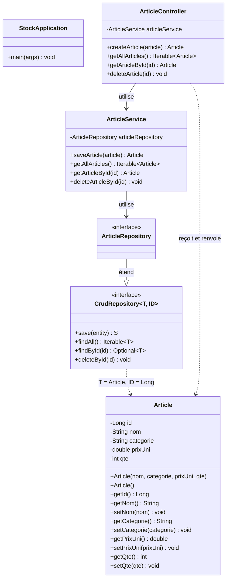

# Diagramme de classes

Le diagramme se lit du haut vers le bas : le Controller appelle le Service, le Service appelle le Repository, et le Repository gère l'entité `Article`.

## Légende

- `-` : attribut privé
- `+` : méthode publique
- `-->` : une classe utilise l'autre
- `--|>` : une interface en étend une autre
- `..>` : dépendance (une classe manipule l'autre sans la stocker)
